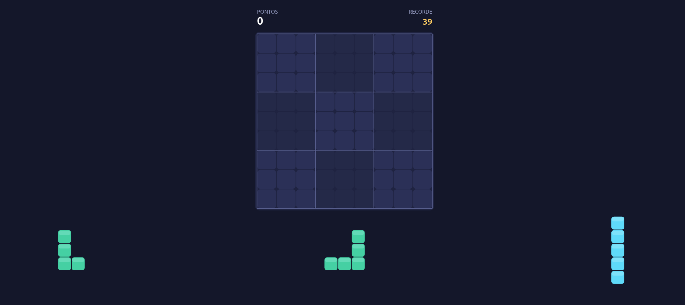

<div align="center">


# Blocos Sudoku

**Puzzle de blocos com regras de Sudoku. Sem anúncios.**

[](https://www.typescriptlang.org)
[](https://vite.dev)
[](https://capacitorjs.com)
[](https://developer.android.com)
[](LICENSE)

</div>

---



## Sobre

Blocos Sudoku é um jogo de puzzle onde arrastas peças para uma grelha 9x9 e limpas linhas, colunas e quadrados 3x3 completos, como no Sudoku. Foi feito como alternativa **sem anúncios** aos jogos do género, com código aberto e pronto para correr no browser ou como app Android.

## Funcionalidades

- 🧩 Grelha 9x9 com 3 peças de cada vez (34 formas diferentes)
- 👆 Drag and drop por toque, com pré-visualização de onde a peça vai cair
- 💥 Limpeza de linhas, colunas e quadrados 3x3, com flash visual
- 🔥 Pontuação com bónus por combos e por limpar várias unidades de uma vez
- 🏆 Recorde guardado localmente (`localStorage`)
- 📳 Vibração ao pegar, colocar e limpar
- 📴 Funciona offline
- 🚫 Zero anúncios, zero tracking

## Como se joga

1. Arrasta uma das 3 peças para a grelha. As peças não rodam.
2. Completa uma linha, coluna ou quadrado 3x3 para o limpar.
3. Limpar vários de uma vez ou em jogadas seguidas dá mais pontos.
4. O jogo acaba quando nenhuma das peças restantes cabe no tabuleiro.

## Stack

| Camada     | Tecnologia                          |
| ---------- | ----------------------------------- |
| Linguagem  | TypeScript 5                        |
| Build      | Vite 7                              |
| Gráficos   | HTML5 Canvas (sem framework de UI)  |
| Mobile     | Capacitor 7 (Android)               |
| Guardar    | localStorage                        |
| Deploy web | Vercel                              |

## Correr localmente

```bash
# 1. Clonar o repositório
git clone https://github.com/teu-username/blocos-sudoku.git
cd blocos-sudoku

# 2. Instalar dependências
npm install

# 3. Arrancar o servidor de desenvolvimento
npm run dev
```

Abre [http://localhost:5173](http://localhost:5173) no browser. Para testar o toque, usa o modo telemóvel das DevTools (F12).

## Build para produção

```bash
npm run build
```

A pasta `/dist` fica pronta para deploy em qualquer hosting estático (Vercel, Netlify, GitHub Pages).

## Gerar a app Android

Precisas do [Android Studio](https://developer.android.com/studio) instalado.

```bash
npx cap add android   # só a primeira vez
npm run android       # build + sync + abre o Android Studio
```

No Android Studio: **Build > Build APK(s)**, ou liga o telemóvel por USB e carrega em **Run**.

> Antes de gerar a app, muda o `appId` em `capacitor.config.ts` (por exemplo `io.github.teu-username.blocossudoku`).

## Estrutura do projeto

```
├── index.html
├── capacitor.config.ts     # configuração da app Android
├── vite.config.ts
├── public/
│   └── favicon.svg         # ícone da app
└── src/
    ├── pieces.ts           # formas das peças e geração aleatória
    ├── game.ts             # lógica: colocar, limpar, pontuação, fim de jogo
    ├── main.ts             # desenho em canvas e drag and drop
    └── style.css
```

## Licença

MIT. Livre para usar, modificar e distribuir.

---

<div align="center">
  <sub>Feito com ☕ e TypeScript · Inspirado no género de puzzles block + sudoku</sub>
</div>
